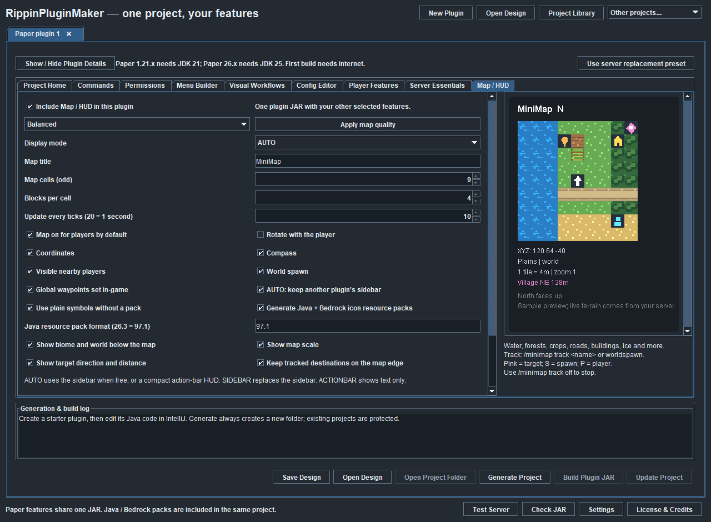

# RippinPluginMaker

**Make Minecraft Paper plugins with a Windows desktop app.** Created by **RippingDaisy913**.

## Download Public Preview 1

**[Download the Windows ZIP](https://github.com/RippingDaisy913/RippinPluginMaker/releases/download/v4.8.0-preview.1/RippinPluginMaker-4.8.0-Preview.1-Windows.zip)**

[Release notes](https://github.com/RippingDaisy913/RippinPluginMaker/releases/tag/v4.8.0-preview.1) · [Report a problem](https://github.com/RippingDaisy913/RippinPluginMaker/issues)

This is an early public test preview based on the verified **4.8.0** build. The app displays version 4.8.0. Please try generated plugins on a separate test server first.

## Quick start

1. Download and **extract the entire Windows ZIP**.
2. Install **Java 21+** to run the app. **JDK 25** is required for generated Paper 26.x plugins.
3. Run **RippinPluginMaker.bat** in the extracted folder.
4. Enter your plugin details and select the features you want.
5. Choose **Generate Project**, then **Build Plugin JAR**. First builds need internet.
6. Install the resulting plugin from your project's **build/libs** folder on your test server.

The optional installer creates user shortcuts. Java is not bundled. GitHub's automatic “Source code” archives contain this download page's documentation; use the **Windows ZIP** above for the app.

## What you can try

- **Commands and permissions:** create a complete Gradle/IntelliJ Paper plugin project.
- **Menus:** create inventory menus and configure button actions.
- **AFK and RTP zones:** configure countdowns, workflows and in-game zone setup.
- **Server essentials:** selected home, warp, teleport and utility features.
- **Minimap:** a sidebar terrain grid with optional Java and Bedrock icon resource packs.
- **Projects:** save/reopen designs, update generated source with backups, and inspect plugin JARs.
- **Appearance:** dark mode by default on fresh installs, plus Light/System and scrolling options.

## Try the minimap starter

Use **Open Design > Examples/Minimap Starter.json** in the preview ZIP. Its map is already enabled and uses SIDEBAR mode with Balanced settings. Generate and build the project, install its plugin JAR, restart the test server, and try `/minimap on` and `/minimap help`.

Start with plain symbols, which work without a resource pack. Graphical tiles need the matching pack installed, followed by `/minimap style icons`. Java and Bedrock use separate packs; follow [MAP_SETUP.md](MAP_SETUP.md).

*This is the app's sample preview. Actual terrain is sampled from loaded chunks on the server.*

When making your own map project, check **“Include Map / HUD in this plugin.”** Changing map settings alone does not enable the feature. For an existing project, use **Update Project** to apply changes, then build and install the new JAR.

## Testing and feedback

Please follow [TESTING.md](TESTING.md) and review [KNOWN-LIMITATIONS.md](KNOWN-LIMITATIONS.md). Use [BUG-REPORT.txt](BUG-REPORT.txt) when opening an issue. Include steps, expected/actual results, versions and the relevant error. Remove passwords, tokens and private addresses from logs.

The underlying release passed **605 automated/simulated checks**. See [VERIFICATION.md](VERIFICATION.md) for the tested scope. Real Minecraft Java/Bedrock rendering and resource-pack acceptance still need testers' feedback. Paper is the primary supported generation path; Fabric and some project types are experimental or preview-only.

## License and ownership

The compiled app may be used for personal or commercial projects under its included **Product Use License**. Existing open-source component permissions are preserved. Generated Paper/HUD starter code and original map artwork carry **MIT**.

Read [LICENSE](LICENSE), [LICENSING.md](LICENSING.md) and [THIRD-PARTY-NOTICES.txt](THIRD-PARTY-NOTICES.txt). This repository distributes the app download and documentation. Proprietary application source is not included.

Copyright (c) 2026 RippingDaisy913. Not affiliated with Mojang or Microsoft.
